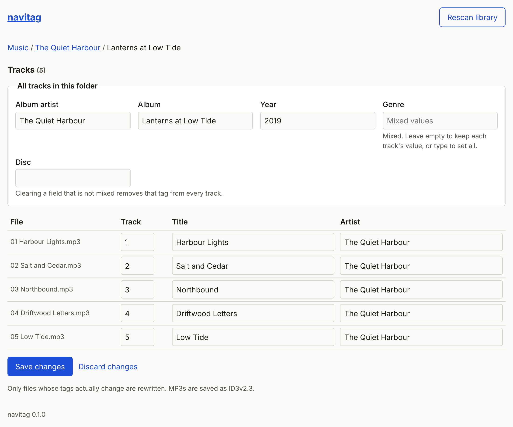

# navitag

A small, self-hosted web editor for music tags. Point it at your music folder, open it in a browser, fix album and track tags, and (optionally) tell Navidrome to rescan.

Built for home servers that already run [Navidrome](https://www.navidrome.org/) or another Subsonic-compatible server, including a Raspberry Pi. One container, no database. The app process uses roughly 35 to 40 MB of RAM (measured on amd64 with a small library).



## Features

- Browse your library folder by folder.
- Edit album-wide fields once for every track in a folder: album artist, album, year, genre, disc.
- Edit per-track number, title and artist in a table.
- Mixed values are shown as "Mixed values": leave the field empty to keep each track's own value, or type to set them all.
- Only files whose tags actually change are rewritten.
- MP3 (ID3v2.3 by default, or v2.4), FLAC, M4A/MP4, Ogg Vorbis, Opus, via [mutagen](https://mutagen.readthedocs.io/).
- Ignores macOS `._*` files and non-audio files.
- "Rescan library" button for Navidrome or any Subsonic server.
- Optional password login. CSRF protection on every form.
- Accessible: labelled inputs, keyboard and screen reader friendly, light and dark themes.

Not included (yet): cover art, renaming or moving files, lookups from MusicBrainz or other online sources. For those, [MusicBrainz Picard](https://picard.musicbrainz.org/) or [beets](https://beets.io/) are better tools.

## Quick start (Docker Compose)

```yaml
services:
  navitag:
    image: ghcr.io/jamesfmcgrath/navitag:latest
    container_name: navitag
    restart: unless-stopped
    user: "1000:1000"            # the owner of your music files: ls -ln /path/to/music
    ports:
      - "127.0.0.1:8000:8000"
    volumes:
      - /path/to/music:/music
    environment:
      NAVITAG_PASSWORD: "change-me-to-something-long"
```

```bash
docker compose up -d
```

Open http://localhost:8000. A fuller example is in [`docker-compose.example.yml`](docker-compose.example.yml).

Images are published for `linux/amd64` and `linux/arm64` (Raspberry Pi 3/4/5 on a 64-bit OS).

## Configuration

| Variable | Default | Purpose |
|---|---|---|
| `NAVITAG_MUSIC_ROOT` | `/music` | Folder to browse and edit. |
| `NAVITAG_PASSWORD` | (unset) | Enables the login page. Without it, anyone who can reach the port can edit your tags. |
| `NAVITAG_SECRET_KEY` | random per start | Signs session cookies. Set it to keep users logged in across restarts. |
| `NAVITAG_COOKIE_SECURE` | `false` | Set `true` when served over HTTPS. |
| `NAVITAG_TITLE` | `navitag` | Page title and heading. |
| `NAVITAG_ID3_VERSION` | `3` | `3` (widest player support) or `4`. MP3 only. |
| `NAVIDROME_URL` | (unset) | Base URL of Navidrome or another Subsonic server, for the rescan button. |
| `NAVIDROME_USER` | (unset) | User for the rescan call. Must be an admin. |
| `NAVIDROME_PASSWORD` | (unset) | Password for that user. Alternatively set `NAVIDROME_TOKEN` and `NAVIDROME_SALT` (token = md5(password + salt)). |
| `PORT` | `8000` | Listen port inside the container. |

The rescan button only appears when the Navidrome settings are complete. If Navidrome runs on the host and navitag in Docker, use `http://host.docker.internal:4533` and add `extra_hosts: ["host.docker.internal:host-gateway"]`.

## Security

navitag can rewrite every audio file under the folder you mount. Treat it like an admin tool:

- **Do not expose it to the internet without a password.** Prefer a private network (Tailscale, WireGuard), bind to `127.0.0.1`, or put an authenticating reverse proxy in front.
- With `NAVITAG_PASSWORD` set, use HTTPS and `NAVITAG_COOKIE_SECURE=true`. The login has a basic delay on wrong passwords but no lockout.
- Mount only your music folder, read-write. The container runs as a non-root user.
- Paths are confined to `NAVITAG_MUSIC_ROOT`; requests that try to escape it return 404.

## Backups

Tag edits rewrite files in place. Keep a backup of your library (restic, borg, Time Machine, anything) so a bad batch edit can be undone.

## Development

```bash
python -m venv .venv && . .venv/bin/activate
pip install -r requirements-dev.txt
NAVITAG_MUSIC_ROOT=/path/to/test/music python -m navitag.app
python -m pytest -q        # needs ffmpeg to generate test audio
```

## Licence

[MIT](LICENSE)
